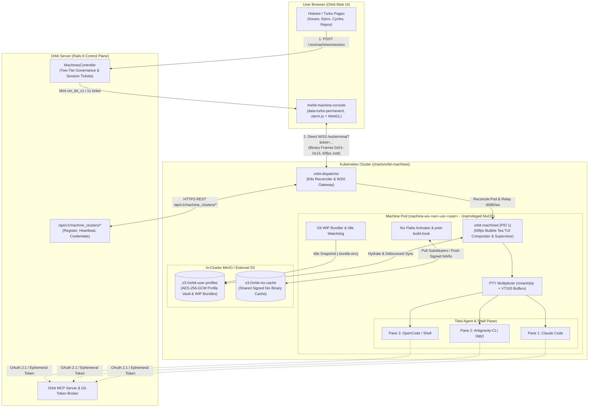

<h1 align="center">Orbit Machines</h1>

<p align="center">
  <b>Ephemeral, Nix-powered cloud development machines and 60fps Bubble Tea TUI compositor on Kubernetes for <a href="https://github.com/davidschrooten/orbit">Orbit</a> workspaces.</b>
</p>

<p align="center">
  <a href="https://github.com/davidschrooten/orbit-machines/actions/workflows/ci.yml"></a>
  <a href="https://github.com/davidschrooten/orbit-machines/actions/workflows/release.yml"></a>
  <a href="go.mod"></a>
  <a href="Makefile"></a>
  <a href="flake.nix"></a>
  <a href="charts/orbit-machines"></a>
</p>

---

## Overview

**Orbit Machines** (`github.com/davidschrooten/orbit-machines`) is the self-hosted, Kubernetes-native remote agentic development platform for [Orbit](https://github.com/davidschrooten/orbit) workspaces. Engineers open a persistent, GCP Cloud Shell-style bottom console drawer (`#orbit-machine-console`) directly inside Orbit—expandable to a docked split view or full-screen overlay—and connect over compressed binary WebSockets to an unprivileged NixOS-based Pod running their workspace repositories, Nix flake development shells, and AI coding agents (**Claude Code**, **Antigravity-CLI**, and **OpenCode**) pre-wired to Orbit's Model Context Protocol (MCP) server.

The module compiles two static Go binaries designed around hexagonal ports-and-adapters boundaries:

1. **`orbit-dispatcher`** (`cmd/orbit-dispatcher`) — **Kubernetes Control-Plane & WebSocket Gateway**
   - Installed into the workspace's Kubernetes cluster via `./charts/orbit-machines`.
   - Pairs with the Orbit Rails monolith over HTTPS REST (`/api/v1/machine_clusters/*`), sending periodic capacity/session heartbeats and requesting short-lived per-Pod Orbit MCP and Git tokens.
   - Verifies short-lived `om_tkt_v1` (`v1.<payload>.<sig>`) session tickets signed by Orbit using Ed25519 / HMAC-SHA256 key derivation.
   - Reconciles isolated, unprivileged Machine Pods (`machine-ws-<ws>-usr-<user>`) with tiered compute quotas (`standard` / `performance`), `RuntimeDefault` seccomp profiles, and zero Linux capabilities.
   - Terminates browser `xterm.js` WebSocket connections (`wss://<ingress-host>/ws/terminal`) and relays binary frames (`0x01`–`0x13`) directly to the user's Pod without putting Ruby/Rails in the real-time byte path.

2. **`orbit-machined`** (`cmd/orbit-machined`) — **In-Pod PID 1 Supervisor & 60fps Bubble Tea TUI Compositor**
   - Hydrates and continuously syncs the user's AES-256-GCM envelope-encrypted home vault (`profile.tar.zst.enc`) from S3/MinIO (`s3://orbit-user-profiles`), preserving `~/.config/orbit-machine`, `~/.claude`, `~/.config/opencode`, and `~/.gemini` across ephemeral Pod lifecycles.
   - Multiplexes full-screen child TUIs (`claude`, `agy`, `opencode`, interactive shells) inside `creack/pty` pseudo-terminals backed by virtual terminal screen buffers, emitting `zstd`-compressed dirty diffs at a capped **60fps (`16ms` budget)** with instant full-screen snapshot recovery on reconnect.
   - Activates repository `flake.nix` environments via `nix print-dev-env --json` backed by a cluster-wide shared S3/MinIO Nix binary cache (`s3://orbit-nix-cache`) and `orbit-machined hook-upload` post-build signing hook.
   - Launches an interactive **Flake Init Wizard** for repositories without a `flake.nix` and a **Built-in AI Configurator** (`✦ Configure`) that live-reloads TUI layouts, leader keybindings, shell profiles, and Nix packages.
   - Monitors user activity and automatically bundles uncommitted Git work (`git bundle` + working-tree patch encrypted to S3) before idle Pod shutdown, prompting for one-keystroke restoration on next boot.

---

## Architecture



### Repository Layout

```text
orbit-machines/
├── AGENTS.md                        # Repository rules & architectural guardrails
├── agent-docs/                      # Deep-dive specifications & cross-repo contracts
├── Makefile                         # Build, race-enabled test, coverage & lint targets
├── flake.nix                        # Reproducible Nix devShell & OCI image builder
├── cmd/
│   ├── orbit-dispatcher/            # Cluster-level K8s controller & WebSocket gateway
│   └── orbit-machined/              # In-Pod PID 1 supervisor, TUI host & Nix cache hook
├── internal/
│   ├── config/                      # Viper/pflag 12-factor config loaders & validation
│   ├── domain/                      # Pure domain types, invariants & sentinel errors
│   ├── ticket/                      # Session ticket (om_tkt_v1 / v1) signing & verification
│   ├── protocol/                    # Binary WebSocket frame codec (0x01–0x13) & REST DTOs
│   ├── orbitclient/                 # Orbit Rails control-plane HTTPS REST client
│   ├── dispatcher/                  # Gateway HTTP/WSS handlers & session orchestration
│   ├── k8s/                         # Kubernetes Pod builder, reconciler & garbage collector
│   ├── storage/                     # S3/MinIO adapter & AES-256-GCM envelope encryption
│   ├── gitwip/                      # Dirty working tree detection & git bundle save/restore
│   ├── nixenv/                      # Flake devshell evaluation, Nixpkgs search & generator
│   ├── machined/                    # Boot hydration, idle watchdog & graceful teardown
│   ├── pty/                         # creack/pty lifecycle & virtual terminal screen buffer
│   └── tui/                         # 60fps Bubble Tea tiling WM, leader chords & WSS server
└── charts/
    └── orbit-machines/              # Kubernetes Helm chart (Dispatcher, RBAC, NetworkPolicy, MinIO)
```

---

## Binary WebSocket Protocol & Session Tickets

### Session Tickets (`om_tkt_v1` / `v1.<payload>.<sig>`)

When an authorized engineer opens or reconnects `#orbit-machine-console`, Orbit issues a short-lived (`TTL <= 120s`, `15s` max clock skew) session ticket verified statelessly by `orbit-dispatcher` before upgrading `/ws/terminal`:

```text
v1.<base64url-unpadded-json-payload>.<base64url-unpadded-signature>
```

- **Key Derivation & Signatures**: Derived deterministically via domain-separated HMAC-SHA256 (`orbit-machines:session-ticket:v1`) from the workspace cluster token (`omc_live_...`) or verified with Ed25519 (`om_tkt_v1`).
- **Authenticated Claims Payload**:
  ```json
  {
    "jti": "01960000-0000-7000-8000-000000000001",
    "iss": "orbit",
    "sub": "usr_42",
    "ws_id": "ws_99",
    "ws_slug": "acme",
    "user_login": "david",
    "tier": "performance",
    "iat": 1762264800,
    "exp": 1762264860
  }
  ```

### Binary WebSocket Framing (`0x01`–`0x13`)

All interactive terminal traffic on `/ws/terminal` (and in-cluster `:8080/ws`) uses binary WebSocket messages prefixed with a 1-byte opcode header and bounded by a 4 MiB maximum payload guard:

| Opcode | Frame Name | Direction | Wire Payload | Description |
|---|---|---|---|---|
| `0x01` | `FrameInput` | Client → Server | `<raw-utf8-or-ansi-bytes>` | Keyboard input and X10/SGR mouse events routed through the `Ctrl+Space` leader engine or active PTY pane. |
| `0x02` | `FrameResize` | Client → Server | `<uint16-be-cols><uint16-be-rows>` (4 B) | Browser `xterm.js` viewport resize (`cols > 0`, `rows > 0`); recomputes tiled pane geometries (`TIOCSWINSZ`). |
| `0x03` | `FramePing` | Client → Server | `<uint64-be-client-ts-ms>` (0 or 8 B) | Client latency probe and activity heartbeat; resets the Pod's inactivity shutdown timer. |
| `0x10` | `FrameSnapshot` | Server → Client | `<zstd-compressed-ansi-bytes>` | Full terminal screen snapshot emitted immediately on initial connect, reconnect, or viewport resize. |
| `0x11` | `FrameDiff` | Server → Client | `<zstd-compressed-ansi-bytes>` | Coalesced 60fps (`16ms` tick) incremental ANSI screen diff emitted only when a pane or overlay is dirty. |
| `0x12` | `FramePong` | Server → Client | `<uint64-be-client-ts-ms>` (0 or 8 B) | Heartbeat response echoing the client timestamp for live RTT display in the console header bar. |
| `0x13` | `FrameMetadata` | Server → Client | `<utf8-json-bytes>` | Out-of-band control JSON event (`boot_progress`, `idle_warning`, `session_state`, `wip_restore_prompt`). |

---

## TUI Compositor & `Ctrl+Space` Leader Key Chords

Because Orbit Machines runs inside a web browser where standard shortcuts (`Ctrl+W`, `Ctrl+T`, `Ctrl+N`) are captured by the browser, `orbit-machined` provides a **browser-safe leader key engine** (`Ctrl+Space` / `0x00` by default, customizable via the AI Configurator) paired with full mouse support (click-to-focus panes, drag split borders between `20%` and `80%`, and clickable top-bar actions).

### `Ctrl+Space` Leader Key Reference

Press **`Ctrl+Space`** followed by any chord key below:

| Leader Chord | Action | Description |
|---|---|---|
| `Ctrl+Space` → `v` | **Vertical Split** | Switch active tab to side-by-side vertical split layout and spawn a new shell pane. |
| `Ctrl+Space` → `s` | **Horizontal Split** | Switch active tab to stacked horizontal split layout and spawn a new shell pane. |
| `Ctrl+Space` → `h` / `j` / `k` / `l` | **Focus Navigation** | Move focus left (`h`), down (`j`), up (`k`), or right (`l`) across tiled panes in the active tab. |
| `Ctrl+Space` → `z` | **Toggle Zoom** | Maximize the focused pane to fill the workspace viewport, or restore the tiled split layout. |
| `Ctrl+Space` → `n` | **New Pane / Next Tab** | Spawn a new interactive shell pane in the active repository devshell or advance to the next tab. |
| `Ctrl+Space` → `c` | **Tool Launcher** | Open the Tool Launcher modal (`Claude Code`, `Antigravity-CLI`, `OpenCode`, `Shell`). |
| `Ctrl+Space` → `w` | **Workspace / Flake Wizard** | Open the Workspace Repository & interactive **Flake Init Wizard** overlay (`flake.nix` generator). |
| `Ctrl+Space` → `d` | **Detach / Dismiss** | Dismiss any active modal overlay (`Esc`) or cleanly detach the browser client session. |
| `Ctrl+Space` → `x` | **Close Pane** | Terminate the focused pane's child PTY process and rebalance remaining tiled panes. |
| `Ctrl+Space` → `?` | **Help Overlay** | Display the interactive keybinding & leader chord cheat sheet HUD. |
| `Ctrl+Space` → `r` | **Repository Switcher** | Open the Orbit Workspace Repository Switcher modal. |
| `Ctrl+Space` → `i` | **Orbit Issue Picker** | Open the Issue Picker modal to check out an issue branch and inject Orbit MCP issue context. |
| `Ctrl+Space` → `a` | **AI Configurator** | Open the **Built-in AI Configurator** (`✦ Configure through an AI`) for live hot-reload customization. |
| `Ctrl+Space` → `1`..`9` | **Select Repo Tab** | Switch directly to workspace repository tab `1` through `9`. |

---

## Quick Start

### 1. Enter the Nix Flake Development Shell

The repository's `flake.nix` provides a hermetic toolchain with Go, `golangci-lint`, `gopls`, `helm`, `kubectl`, `zstd`, and `jq`:

```sh
nix develop
# or with direnv:
direnv allow
```

### 2. Build & Run the Test Suite

```sh
# Compile bin/orbit-dispatcher and bin/orbit-machined
make build

# Run all unit and integration tests with the race detector and coverage report
make test

# Enforce the >= 95% statement coverage gate (currently 95.8%)
make test-coverage

# Run golangci-lint and Helm chart linter
make lint
make helm-lint
```

### 3. CLI Flags & Environment Variables

Both binaries follow strict 12-factor configuration via `spf13/cobra` and `spf13/viper`. Every CLI flag can be set via environment variables (`ORBIT_DISPATCHER_*`, `ORBIT_MACHINED_*`, or shared `ORBIT_MACHINES_*` overrides) or a YAML/TOML config file (`--config / -c`).

#### `orbit-dispatcher serve`

| CLI Flag | Environment Variable | Default | Description |
|---|---|---|---|
| `--listen-addr` | `ORBIT_DISPATCHER_LISTEN_ADDR` | `:8080` | HTTP control-plane and WebSocket gateway listen address. |
| `--orbit-url` | `ORBIT_DISPATCHER_ORBIT_URL` | *(required)* | Base URL of the Orbit Rails server (`https://orbit.example.com`). |
| `--cluster-token` | `ORBIT_DISPATCHER_CLUSTER_TOKEN` | *(required)* | Shared cluster bearer token (`omc_live_...`, min 16 chars). |
| `--ingress-host` | `ORBIT_DISPATCHER_INGRESS_HOST` | *(required)* | Public WebSocket ingress hostname (`machines.example.com`). |
| `--kubernetes-namespace` | `ORBIT_DISPATCHER_KUBERNETES_NAMESPACE` | `orbit-machines` | Kubernetes namespace where ephemeral Machine Pods are scheduled. |
| `--machine-image` | `ORBIT_DISPATCHER_MACHINE_IMAGE` | `ghcr.io/davidschrooten/orbit-machined:latest` | NixOS OCI container image used for Machine Pods. |
| `--max-concurrent-pods` | `ORBIT_DISPATCHER_MAX_CONCURRENT_PODS` | `25` | Maximum concurrent Machine Pods allowed in the cluster. |
| `--heartbeat-interval` | `ORBIT_DISPATCHER_HEARTBEAT_INTERVAL` | `30s` | Interval between control-plane heartbeats to Orbit. |
| `--s3-endpoint` | `ORBIT_DISPATCHER_S3_ENDPOINT` | `http://orbit-machines-minio:9000` | S3/MinIO endpoint injected into Machine Pods. |
| `--s3-access-key` | `ORBIT_DISPATCHER_S3_ACCESS_KEY` | `""` | S3/MinIO access key ID. |
| `--s3-secret-key` | `ORBIT_DISPATCHER_S3_SECRET_KEY` | `""` | S3/MinIO secret access key. |
| `--s3-profile-bucket` | `ORBIT_DISPATCHER_S3_PROFILE_BUCKET` | `orbit-user-profiles` | Bucket storing encrypted user profiles and WIP git bundles. |
| `--s3-nix-cache-bucket` | `ORBIT_DISPATCHER_S3_NIX_CACHE_BUCKET` | `orbit-nix-cache` | Bucket storing the shared Nix binary cache. |

#### `orbit-machined serve` & `orbit-machined hook-upload`

| CLI Flag | Environment Variable | Default | Description |
|---|---|---|---|
| `--listen-addr` | `ORBIT_MACHINED_LISTEN_ADDR` | `:8080` | In-Pod WebSocket compositor listen address. |
| `--workspace-id` | `ORBIT_MACHINED_WORKSPACE_ID` | *(required)* | Orbit workspace identifier (`ws_...`). |
| `--user-id` | `ORBIT_MACHINED_USER_ID` | *(required)* | Orbit user identifier (`usr_...`). |
| `--resource-tier` | `ORBIT_MACHINED_RESOURCE_TIER` | `standard` | Pod compute resource tier (`standard` or `performance`). |
| `--work-dir` | `ORBIT_MACHINED_WORK_DIR` | `/home/orbit/workspace` | Root directory for cloned workspace repositories. |
| `--profile-encryption-key` | `ORBIT_MACHINED_PROFILE_ENCRYPTION_KEY` | *(32-byte hex)* | 64-character hex AES-256-GCM key for `profile.tar.zst.enc`. |
| `--s3-endpoint` | `ORBIT_MACHINED_S3_ENDPOINT` | `""` | S3/MinIO endpoint URL for profile vault and Nix cache. |
| `--s3-profile-bucket` | `ORBIT_MACHINED_S3_PROFILE_BUCKET` | `orbit-user-profiles` | Bucket for encrypted user profiles and WIP git bundles. |
| `--s3-nix-cache-bucket` | `ORBIT_MACHINED_S3_NIX_CACHE_BUCKET` | `orbit-nix-cache` | Bucket for the shared Nix binary cache (`hook-upload`). |
| `--idle-timeout` | `ORBIT_MACHINED_IDLE_TIMEOUT` | `30m` | Inactivity duration before snapshotting WIP git bundles and exiting. |

Global `ORBIT_MACHINES_*` environment variables (`ORBIT_MACHINES_CONFIG`, `ORBIT_MACHINES_LOG_LEVEL`, `ORBIT_MACHINES_S3_ENDPOINT`) are also supported for container and CI orchestration.

---

## Kubernetes Helm Chart Installation

Workspace administrators deploy `orbit-machines` onto their Kubernetes cluster using the bundled Helm chart in `./charts/orbit-machines`:

```sh
helm upgrade --install orbit-machines ./charts/orbit-machines \
  --namespace orbit-machines --create-namespace \
  --set orbit.url="https://orbit.example.com" \
  --set orbit.clusterToken="omc_live_replace_with_workspace_cluster_token" \
  --set ingress.host="machines.example.com"
```

Or install directly from the published OCI chart registry:

```sh
helm upgrade --install orbit-machines oci://ghcr.io/davidschrooten/charts/orbit-machines \
  --namespace orbit-machines --create-namespace \
  --set orbit.url="https://orbit.example.com" \
  --set orbit.clusterToken="omc_live_replace_with_workspace_cluster_token" \
  --set ingress.host="machines.example.com"
```

### What the Chart Deploys

- **`orbit-dispatcher` Deployment, Service & TLS Ingress**: Stateless gateway configured with WebSocket read/write timeouts and TLS termination.
- **Scoped RBAC (`ServiceAccount`, `Role`, `RoleBinding`)**: Least-privilege permissions restricted to managing Machine Pods and Secrets labeled `app.kubernetes.io/managed-by=orbit-dispatcher` within the release namespace.
- **Zero-Trust `NetworkPolicy`**: Blocks pod-to-pod lateral traffic between user machines, restricts ingress to `orbit-dispatcher` on port `8080`, and blocks cloud metadata endpoints (`169.254.169.254/32`).
- **Shared MinIO Subchart (or External S3)**: Provisions `orbit-user-profiles` and `orbit-nix-cache` buckets out of the box, or connects to AWS S3, Cloudflare R2, or GCS when `minio.enabled=false`.
- **Unprivileged Machine Pod Tiers**: Enforces `runAsNonRoot: true`, UID/GID `1000`, `allowPrivilegeEscalation: false`, dropped `ALL` capabilities, `RuntimeDefault` seccomp, and configurable `standard` (`4 vCPU / 8 GiB`) and `performance` (`8 vCPU / 16 GiB`) resource limits.

---

## Development & TDD Standards

1. **Test-Driven Development (Red → Green → Refactor)**:
   - Every feature or bug fix starts with a failing table-driven test (`_test.go`) at the public package seam using consumer-defined interfaces and deterministic fakes.
   - All packages must pass `go test -race -coverprofile=coverage.txt ./...` with **`>= 95%` statement coverage** (currently **95.8%** across all 15 packages).
2. **Branching & Commit Hygiene**:
   - Branch from `master` using `feat/<topic>`, `fix/<topic>`, `chore/<topic>`, `docs/<topic>`, `refactor/<topic>`, or `test/<topic>`.
   - Merge back into `master` with `git merge --no-ff` after `go test -race ./...`, `golangci-lint run ./...`, and `helm lint charts/orbit-machines` pass.
   - Write concise imperative commit subjects (< 72 characters) with **no `Co-authored-by` trailers**.
3. **Architecture & Wire Contract Documentation**:
   - [`AGENTS.md`](AGENTS.md) — Architectural golden rules and command reference.
   - [`agent-docs/project-overview.md`](agent-docs/project-overview.md) — Product thesis, user journeys, and the 8 build phases.
   - [`agent-docs/architecture.md`](agent-docs/architecture.md) — System topology, hexagonal package layout, and binary WebSocket protocol.
   - [`agent-docs/tui-and-shell.md`](agent-docs/tui-and-shell.md) — Bubble Tea compositor, VT100 emulation, Flake Init Wizard, and AI Configurator.
   - [`agent-docs/nix-and-storage.md`](agent-docs/nix-and-storage.md) — Stateless `/nix/store`, MinIO binary cache hooks, S3 profile encryption, and WIP Git bundles.
   - [`agent-docs/kubernetes-and-helm.md`](agent-docs/kubernetes-and-helm.md) — Helm chart values, RBAC, NetworkPolicies, and Pod security specifications.
   - [`agent-docs/orbit-integration.md`](agent-docs/orbit-integration.md) — Two-tier governance, Rails control-plane API, and `#orbit-machine-console` integration.
